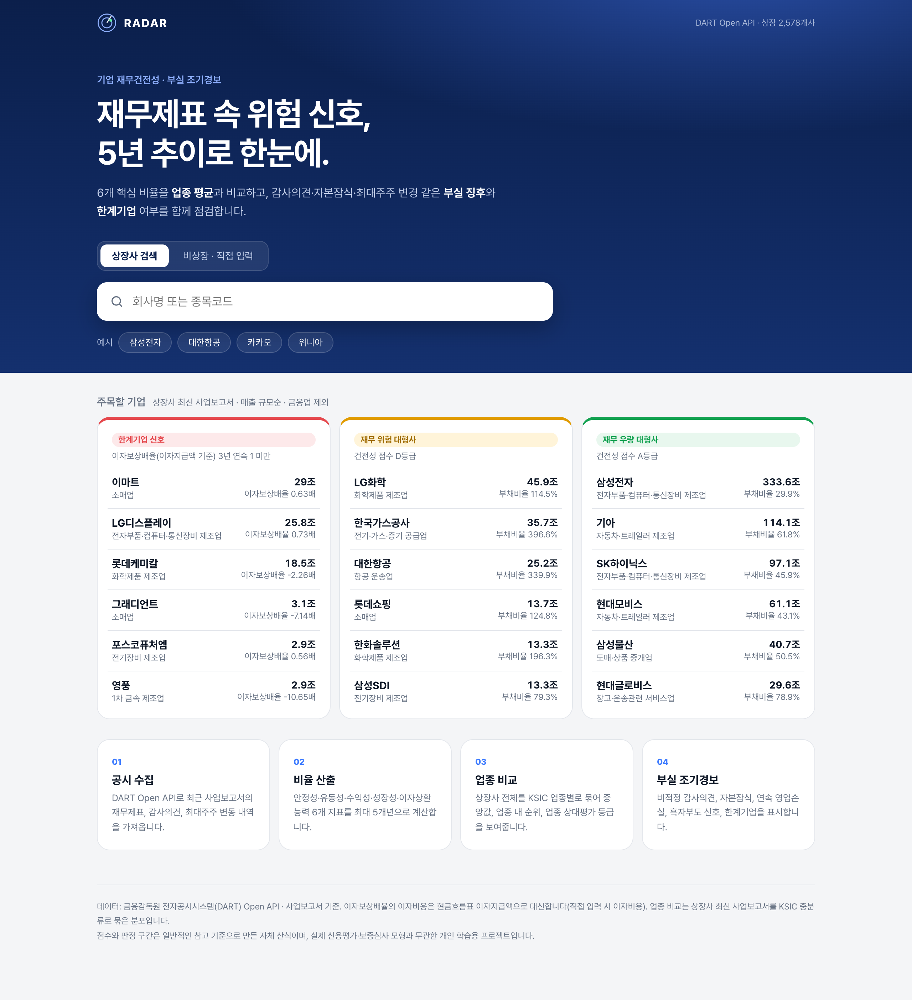
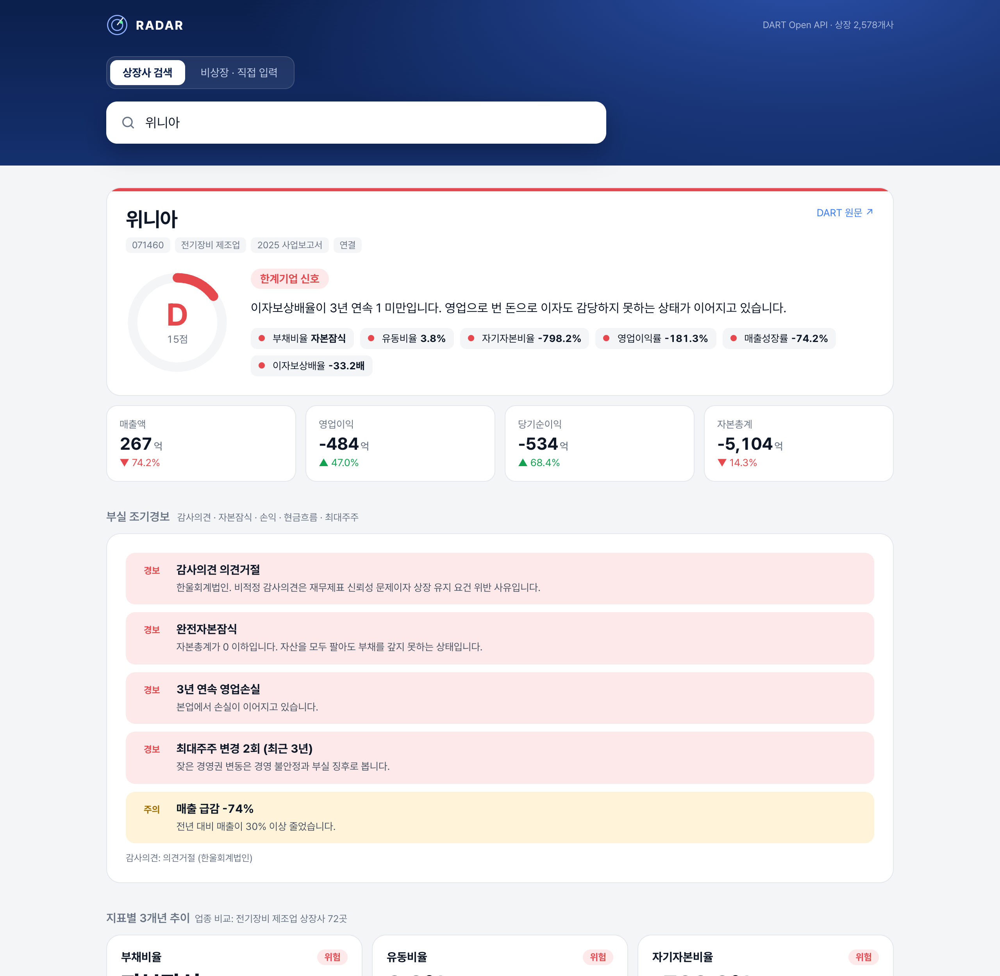
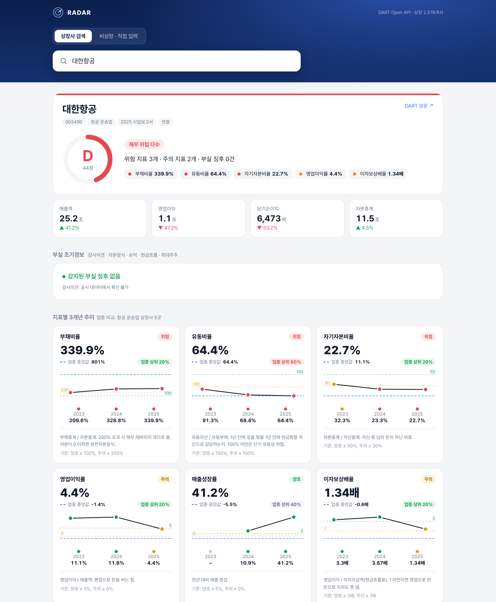
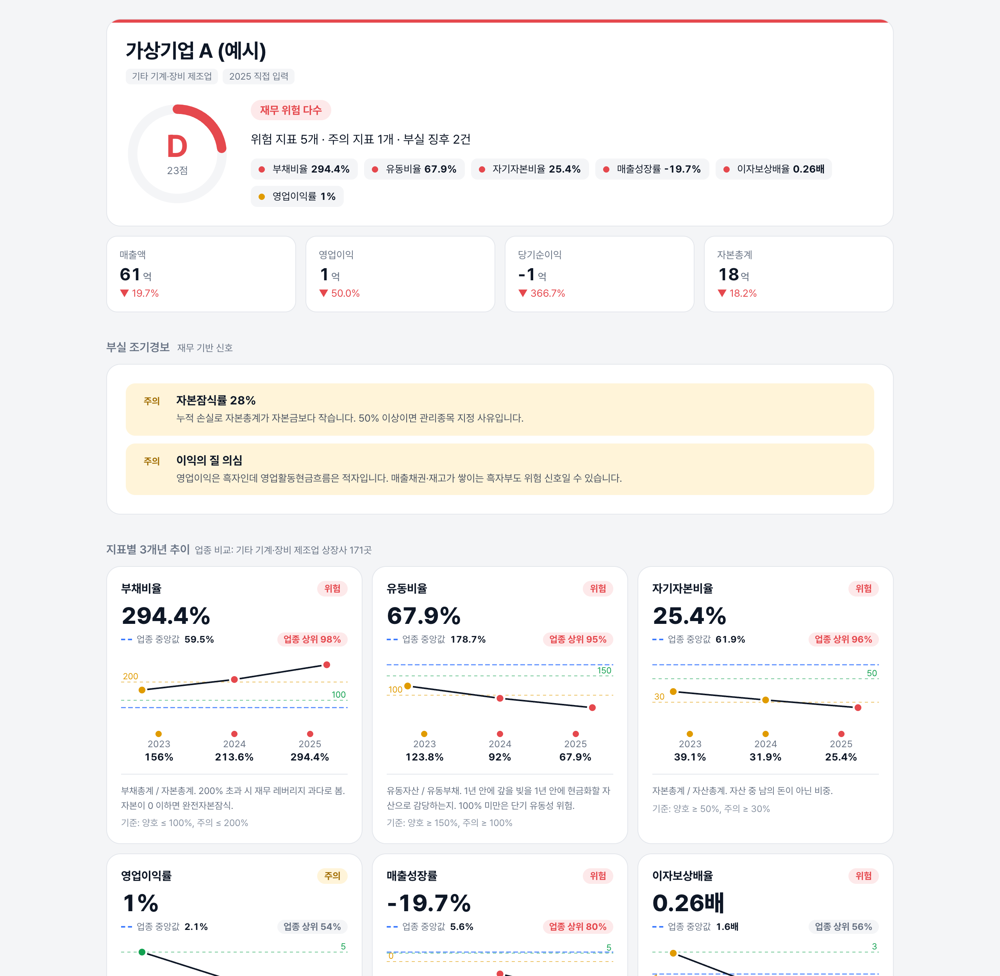
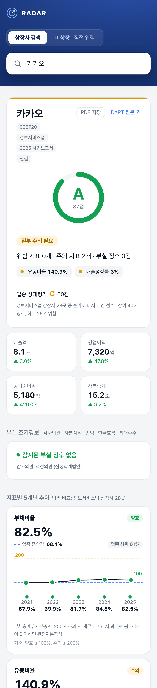

<div align="center">

# 📡 RADAR

**기업 재무건전성 진단 · 부실 조기경보**

전자공시(DART) 재무제표로 6개 핵심 비율을 계산하고, 업종 평균과 비교하며,
감사의견·자본잠식·최대주주 변경 같은 부실 징후와 한계기업 여부를 한 화면에 보여줍니다.

[**🔗 Live Demo**](https://dart-radar-two.vercel.app) · Next.js 16 · TypeScript · DART Open API · Vercel

</div>

<p align="center"></p>

## 왜 만들었나

재무제표는 공개돼 있지만, 숫자를 읽어 **"이 회사가 위험한가"** 를 판단하려면 비율 계산, 업종 특성 고려, 비재무 신호 확인을 따로 해야 합니다.
RADAR는 이 과정을 한 번의 검색으로 묶었습니다. 공시 의무가 없는 **비상장 중소기업**도 숫자만 넣으면 같은 기준으로 진단합니다.

## 주요 기능

| | 기능 | 설명 |
|---|---|---|
| 📊 | **6개 핵심 비율 · 3개년 추이** | 부채비율, 유동비율, 자기자본비율, 영업이익률, 매출성장률, 이자보상배율 |
| 🏭 | **업종 비교** | 상장사 2,578곳을 KSIC 61개 업종으로 묶어 업종 중앙값과 "업종 상위 X%" 표시 |
| 🚨 | **부실 조기경보** | 비적정 감사의견, 계속기업 불확실성, 자본잠식률, 연속 영업손실, 흑자부도 신호, 매출 급감, 최대주주 잦은 변경 |
| 🧟 | **한계기업 판별** | 이자보상배율 3년 연속 1 미만 (한국은행 기준) |
| ✍️ | **비상장 직접 입력** | 재무 숫자 10개만 넣으면 같은 진단. 입력값은 브라우저 밖으로 나가지 않음 |
| ⭐ | **주목할 기업** | 한계기업 신호 · 재무 위험 대형사 · 재무 우량 대형사를 매출 규모순으로 |
| 🔗 | **공유 링크** | `?c=<corp_code>` 로 특정 기업 결과를 바로 열기 |

## 화면

<table>
<tr>
<td width="50%"><b>부실 징후 감지 — 의견거절 · 완전자본잠식 · 한계기업</b><br></td>
<td width="50%"><b>업종 비교 — 절대 기준 D등급이지만 업종 내 상위권</b><br></td>
</tr>
<tr>
<td><b>비상장 직접 입력 — 흑자인데 현금흐름 적자인 가상기업</b><br></td>
<td><b>모바일</b><br></td>
</tr>
</table>

## 판단 기준

| 지표 | 계산 | 양호 | 주의 | 위험 |
|---|---|---|---|---|
| 부채비율 | 부채총계 / 자본총계 | ≤ 100% | ≤ 200% | > 200% 또는 자본잠식 |
| 유동비율 | 유동자산 / 유동부채 | ≥ 150% | ≥ 100% | < 100% |
| 자기자본비율 | 자본총계 / 자산총계 | ≥ 50% | ≥ 30% | < 30% |
| 영업이익률 | 영업이익 / 매출액 | ≥ 5% | ≥ 0% | < 0% |
| 매출성장률 | 전년 대비 | ≥ 5% | ≥ 0% | < 0% |
| 이자보상배율 | 영업이익 / 이자지급액 | ≥ 3배 | ≥ 1배 | < 1배 |

건전성 점수(A~D)는 최근 연도 지표의 신호등을 평균한 **자체 산식**이며, 한계기업이면 30점으로 상한을 둡니다.

## 구조

```
브라우저 ──▶ /api/fin (Route Handler) ──▶ DART Open API
  │              ├ fnlttSinglAcntAll   재무제표 (연결 → 별도, 최근연도 → 전년 순으로 폴백)
  │              ├ accnutAdtorNmNdAdtOpinion   감사의견
  │              └ hyslrChgSttus       최대주주 변동
  │
  ├ lib/ratios.ts    계정 추출 · 비율 · 점수 · 한계기업 (순수 함수, 테스트 포함)
  ├ lib/signals.ts   부실 조기경보 규칙 (순수 함수, 테스트 포함)
  └ public/*.json    빌드 전에 스크립트로 만든 정적 데이터
        corps.json     상장사 목록        ← npm run corps
        peers.json     업종별 비율 분포    ← npm run peers
        featured.json  주목할 기업        ← npm run peers
```

- API 키는 서버(Route Handler)에서만 쓰고, 응답은 하루 단위로 캐시합니다.
- 업종 분포는 요청마다 계산하지 않고 미리 만들어 둡니다. 2,578개사 × 약 2회 호출을 요청 시점에 할 수는 없기 때문입니다.

## 데이터를 다루며 고민한 점

- **계정 매핑** — 회사마다 계정 ID가 다릅니다. 표준 XBRL ID(`ifrs-full_Assets` 등)로 먼저 찾고, 없으면 공백을 제거한 계정명으로 보완합니다.
- **이자비용** — 손익계산서 이자비용은 주석에만 있는 경우가 많아 API로 안정적으로 얻기 어렵습니다. 대신 현금흐름표의 **이자지급액**을 썼고, 화면에 그 사실을 밝혔습니다.
- **자본잠식** — 자본이 0 이하이면 부채비율이 계산되지 않습니다. 빈 값 대신 "자본잠식"으로 표시하고 위험으로 판정합니다.
- **업종 특성** — 항공업은 업종 중앙값 부채비율이 800%에 이릅니다. 절대 기준만 쓰면 업종 전체가 위험으로 나오기 때문에 업종 내 상대 위치를 함께 보여줍니다.
- **상장폐지 기업** — 회사 목록 파일에는 상장폐지 후에도 종목코드가 남아 있습니다. 최근 2년 안에 갱신된 회사만 남겼습니다.

## 실행

```bash
npm install
echo "DART_API_KEY=발급받은키" > .env.local   # https://opendart.fss.or.kr
npm run corps     # 상장사 목록
npm run peers     # 업종 분포 · 주목할 기업 (약 15분, 결과는 scripts/.cache에 캐시)
npm test          # 비율 · 조기경보 규칙 테스트
npm run dev
```

## 한계와 개선 방향

- 금융업(은행·보험·증권)은 재무제표 구조가 달라 일부 지표가 계산되지 않고, 주목할 기업 목록에서도 제외했습니다.
- 감사의견 API는 회사에 따라 값이 비어 있을 수 있어, 이 경우 "확인 불가"로 표시합니다.
- 업종 표본이 작은 경우(예: 항공 운송업 5곳)에는 비교 결과를 조심해서 읽어야 합니다.
- 다음 단계: 5개년 추이, 분기 보고서 반영, 업종별로 다른 판정 기준 적용.

---

<sub>데이터: 금융감독원 전자공시시스템(DART) Open API. 판정 구간과 점수는 일반적인 참고 기준으로 만든 자체 산식이며, 실제 신용평가·보증심사 모형과 무관한 개인 학습용 프로젝트입니다.</sub>
